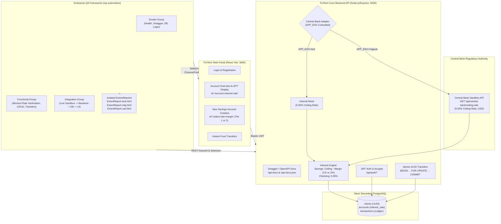
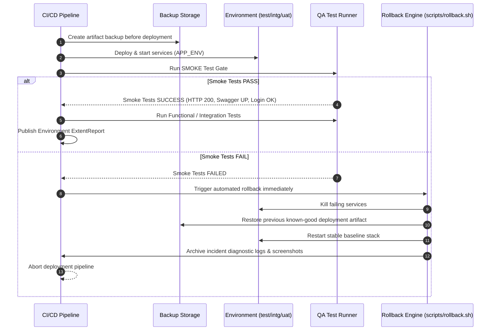

# Charlotte FinTech — Core Banking System & Enterprise Multi-Environment Test Automation


An enterprise-grade **End-to-End FinTech Banking System** and **Multi-Environment QA Test Automation Framework** featuring Central Bank regulatory ceiling rate compliance, interactive Swagger OpenAPI documentation, multi-tier TestNG execution (`smoke`, `functional`, `integration`), environment-isolated ExtentReports, and automated CI/CD rollback on smoke failure.

---

## 1. System Architecture & Central Bank Integration



---

## 2. Central Bank Interest Rate Compliance & Calculation Rules

When creating accounts in the banking system, interest rates are calculated strictly based on regulatory rules:
- **Checking Accounts**: Standard transaction accounts always carry `0.00%` APY.
- **Savings Accounts**: Calculated dynamically by deducting the chosen margin tier from the regulatory ceiling rate:
  - **Tier 1 (Margin 1%)**: `ceilingRate - 1.00%`
  - **Tier 2 (Margin 2%)**: `ceilingRate - 2.00%`

### Environment-Aware Adapter Behavior:
| Environment (`APP_ENV`) | Central Bank Source | Ceiling Rate | Tier 1 Rate | Tier 2 Rate |
| :--- | :--- | :---: | :---: | :---: |
| **`test`** | Internal Mock (no network calls) | `5.00%` | **`4.00%`** | **`3.00%`** |
| **`intg`** | Live Central Bank Sandbox API | `5.50%` | **`4.50%`** | **`3.50%`** |
| **`uat`** | Live Central Bank Sandbox API | `5.50%` | **`4.50%`** | **`3.50%`** |

---

## 3. Interactive Swagger Documentation

Interactive OpenAPI 3.0 documentation is served directly from the Core Backend API:
- **Swagger UI Interactive Console**: `http://localhost:5000/api-docs`
- **OpenAPI JSON Specification**: `http://localhost:5000/api-docs.json`

---

## 4. Multi-Environment CI/CD & Automated Rollback Architecture

Both the **`Jenkinsfile`** and **`.github/workflows/test.yml`** orchestrate a 3-tier progressive delivery pipeline:



### Rollback Script Usage:
```bash
./scripts/rollback.sh <test|intg|uat> [backup_directory]
```
The automated script terminates failing processes, archives failure logs & screenshots to `incident-reports/`, restores the last stable build bundle from `backups/`, and restarts the baseline services.

---

## 5. Running the Application Locally

### Prerequisites
- Node.js 20+
- Java JDK 17 & Apache Maven 3.9+
- Google Chrome

### Step 1: Start Backend API (Port 5000)
```bash
cd backend
cp .env.example .env
# Edit DATABASE_URL & JWT_SECRET if needed
npm install
APP_ENV=test npm start
```
Check health:
```bash
curl http://localhost:5000/api/health
# {"status":"UP","db":"CONNECTED","env":"test"}
```
View Swagger: `http://localhost:5000/api-docs`

### Step 2: Start Frontend Web Portal (Port 3000)
```bash
cd frontend
npm install
npm run dev
```

---

## 6. QA Automation Execution Matrix

Navigate to `/qa-automation`:
```bash
cd qa-automation
```

### Run Smoke Tests (Quick Gate)
```bash
mvn clean test -Denv=test -Dgroups=smoke -DsuiteXmlFile=src/test/resources/testsuites/smoke.xml
```
*Generates: `target/reports/ExtentReport-test.html`*

### Run Functional Tests (Test Env — Mocked Central Bank)
```bash
mvn test -Denv=test -Dgroups=functional -DsuiteXmlFile=src/test/resources/testsuites/functional.xml
```
*Generates: `target/reports/ExtentReport-test.html`*

### Run Integration Tests (Intg Env — Live Central Bank Sandbox)
```bash
mvn test -Denv=intg -Dgroups=integration -DsuiteXmlFile=src/test/resources/testsuites/integration.xml
```
*Generates: `target/reports/ExtentReport-intg.html`*

### Run UAT Smoke Gate
```bash
mvn test -Denv=uat -Dgroups=smoke -DsuiteXmlFile=src/test/resources/testsuites/smoke.xml
```
*Generates: `target/reports/ExtentReport-uat.html`*

### Run Backend Unit Tests (Jest)
```bash
cd backend
npm test
```
*Covers interest rate calculation logic (`ceilingRate - 1%`, `ceilingRate - 2%`), JWT authentication, and API error guards.*
